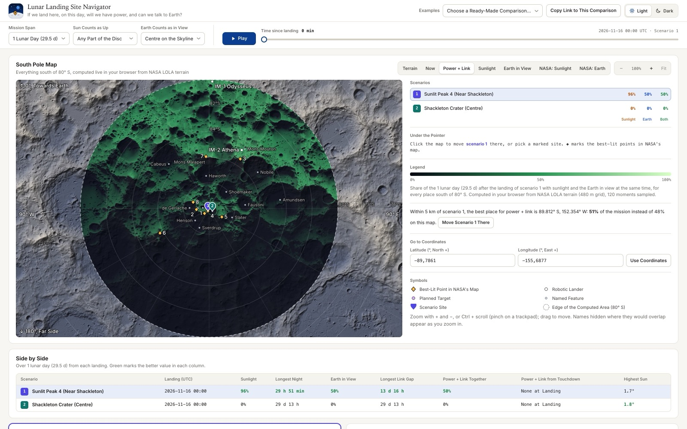

# Lunar Landing Site Navigator

**If we land *here*, on *this day* — will we have power, and can we talk to Earth?**

A web tool that puts the Sun and the Earth against the **real skyline** of the Moon's
south pole, and lets mission planners, educators and anyone curious compare landing
sites and dates side by side in seconds.

**▶ Live application: https://m4tt187.github.io/lunar-landing-site-navigator/**

Built by team **Eallweald, Inc.** for the
[2026 NASA Space Apps Challenge](https://www.spaceappschallenge.org/2026/), challenge
[*Lunar Landing Site Navigator*](https://www.spaceappschallenge.org/2026/challenges/lunar-landing-site-navigator/).



## Why

At the lunar south pole the Sun and the Earth never climb far above the horizon — "~2 to
7 deg", in the words of NASA's Artemis landing-system overview — so a single ridge decides
whether a lander has power and a radio link. NASA's own site-selection paper puts it
plainly: "the Earth must be visible in the lunar sky from the landing site", and "no
single location constantly — or even routinely — has ideal lighting and Earth visibility
conditions". Good sites exist only *for specific periods*. Choosing one means asking the
same question again and again for different places and dates.

The data to answer it are public (JPL Horizons for the ephemeris, the LOLA laser altimeter
for the terrain), but assembling the answer is specialist work. After two real south-polar
landings, a JPL report drew exactly this picture by hand — the Earth's elevation against
a terrain mask computed from elevation maps — to explain why their radio links faded.
This tool draws that picture for any site and any date, instantly, in a browser.

(Sources for the quotations: [docs/references.md](docs/references.md).)

## What it does

- **Compare up to four scenarios side by side.** A scenario is a site, a landing date and
  a height above the ground for the solar panels or antenna. A table marks the better
  value for sunlight, longest night, Earth visibility, longest link gap, and power and
  link together.
- **See the sky the lander would see.** For each scenario: the real skyline all around
  (three depths: nearer than 3 km, 30 km, and everything out to 400 km), the paths of
  the Sun and the Earth over the mission, true-scale close-ups of the solar disc and of
  the Earth against the ridge line, and the time left to the next sunset, sunrise,
  Earthset or Earthrise.
- **Move through time.** One slider (or Play) moves every scenario through its mission.
- **A map that answers "where?".** Computed in the browser for everything south of 80° S:
  where the Sun and the Earth are in view *at this moment* — with shadows that move as
  time plays — and the share of the chosen mission with sunlight, with the Earth in
  view, and with both. It then names the best place for power and link within 5 km of
  the selected site.
- **A calendar that answers "when?".** For every possible landing day of the coming year:
  how long sunlight, the Earth link, or both would last unbroken after touchdown, for
  every scenario, with the best landing days marked.
- **Sites to start from.** Apollo and robotic landing sites with cited coordinates,
  named south-pole features, the eight best-lit points of NASA's long-term illumination
  map — or any coordinates, typed or clicked on the map. A clicked point gets NASA's
  120 m terrain too: the application fetches the nine terrain tiles around it.
- **Eclipses included.** When the Earth passes in front of the Sun — a lunar eclipse,
  seen from the Earth — the sunlight is counted as lost for as long as the chosen rule
  says, in the numbers and on the map. Seen from the south pole, the eclipse of 14 March
  2025 covered the whole Sun for 2 h 48 min.
- **Rules you can change.** What counts as "Sun up" (any part of the disc, half, or all
  of it) and as "Earth in view" (its centre on the skyline, or 2° or 5° above it, since
  links that graze the terrain fade).
- **Ready-made comparisons** for a first look, and a **link** that reproduces any
  comparison exactly.
- **A recommendation, not only a comparison.** The engine can search every site with a
  real skyline and every landing date of a year for the mission you describe — so many
  days of operations, a lander that survives so many hours of darkness — and rank the
  site-and-date pairs: power for the whole mission first, then the most contact with the
  Earth. Today from the command line (`npx tsx tools/planning/recommend.ts`, see
  [docs/engine/planning.md](docs/engine/planning.md)).

Plain-language sentences accompany the numbers, so the same screen serves a planner who
wants degrees and hours and a student who wants to know why the pole is hard.

## How it works

Everything is computed in the browser; there is no server.

1. **Where the Sun and the Earth are.** Their positions relative to the Moon come from
   the open-source Astronomy Engine; the Moon's orientation follows the IAU rotation
   model. For a site this gives azimuth, elevation, apparent size and distance, with
   light-time, aberration and the observer's position on the surface taken into account.
   The positions are computed exactly every two hours, once for all sites, and
   interpolated in between, so that every mission can be sampled every ten minutes.
2. **What the terrain hides.** From the site, rays are marched over NASA's LOLA elevation
   model in every direction (every 0.25°), out to 400 km on the curved Moon. The highest
   elevation angle found along each ray is the skyline. Marked sites use the complete
   120 m model; a clicked point uses the same 120 m model for at least 30 km around it
   and a 480 m reduction beyond.
3. **What the Earth hides.** The Earth's disc, enlarged by 75 km of opaque air as in
   NASA's eclipse predictions, is tested against the Sun's at every sample.
4. **What it means.** The Sun counts as up when the chosen fraction of its disc is above
   the skyline in its direction and not covered by the Earth; the Earth when it clears
   the skyline by the chosen margin. From samples ten minutes apart through the mission
   come the shares of time, the windows, the longest night and the longest link gap.
5. **The whole map at once.** For a distant light the terrain is resampled into a frame
   aligned with the light's direction; one running maximum per row then tells every
   place at once whether it sees the light. A whole-map answer takes about a tenth of a
   second, so the map layers are computed live, in background workers. During an eclipse
   every place is also tested against the Earth's disc as seen from that place.

Full description, conventions and formulas: [docs/methodology.md](docs/methodology.md).
The engine, module by module: [contract](docs/engine/contract.md),
[ten-minute sampling](docs/engine/ephemeris.md), [eclipses](docs/engine/eclipses.md),
[planning](docs/engine/planning.md), [terrain tiles](docs/engine/tiles.md).

## How far to trust it

| Check | Result |
|---|---|
| Sun and Earth directions against **NASA/JPL Horizons** (9,810 reference values: nine sites, five time windows, 2026–2035) | largest difference **0.004°** (the Sun's disc is 0.53° wide); the test fails above 0.01° |
| Earth elevation at two **real landings** against a JPL report | IM-1: 15.4° on the landing day and 9.6° a week later (JPL: "15 deg at landing down to 10 deg during the last contact"); Chandrayaan-3: 13.0° above the horizontal at landing (JPL: "approximately 11°" above the local terrain) |
| Share of time with sunlight and with the Earth in view against the **NASA LOLA-team illumination maps**, at 400 places south of 85.4° S over 18.6 years | correlation **0.98** for both; mean absolute difference 0.010 (Sun) and 0.012 (Earth); 96 % and 94 % of places within 0.05 |
| Eclipses against **NASA's lunar eclipse predictions** (Goddard Space Flight Center), all 14 eclipses of 2025–2030 | 58 contact times within **8.3 s** (root mean square 3.5 s); the two contacts of the eclipse that only grazes the Moon (18 July 2027) within 52 s, which is 0.7″ |
| The eclipse of 14 March 2025 at the **Blue Ghost Mission 1** landing site against the mission's own prediction (Firefly Aerospace, NASA CLPS) | first and last contact within half a minute; start of totality within 2.1 min; the three photographs the lander took fall in the phases computed for their times |
| A clicked point (120 m tiles nearby, 480 m beyond) against the complete 120 m model, 100 random places south of 80° S | yearly sunlight within **0.11** percentage points, Earth visibility within 0.12 (the 480 m model alone: up to 17.5 and 15.3) |
| Ten-minute sampling: interpolated Sun and Earth directions against the exact ones, 25,000 cases | largest difference 1.4 × 10⁻⁷ ° |
| Ends of the sunlight and Earth-visibility windows from ten-minute samples against one-minute samples and the exact crossing, 25 sites, four months of 2027 | 354 window ends: half within 0.02 s, 95 % within 14.4 s, the largest **6.5 min** off; two events shorter than ten minutes are missed |
| Planning (operating window, landing calendar) against a minute-by-minute simulation | same answer in 700 random cases |
| Whole-map sweep against an independent ray march over the same 480 m model, at places south of 84° S | same answer for 98.9 % (Sun) and 99.5 % (Earth) of 1,280 place-and-time pairs; above 99.3 % away from shadow edges |
| The map during an eclipse against each place's own answer (its own sky, its skyline on the same 480 m model, the Earth's disc), 2,500 random cells while the Earth covers part of the Sun | same answer at 99.1 % ("any part of the Sun") and 99.0 % ("half the disc") of the cells; where the Earth alone hides the Sun, 393,300 comparisons without a difference |
| Automated tests | 317 tests in 19 files, run with `npm test` (one compares the terrain tiles with the 116 MB NASA source file and is skipped when that file has not been downloaded) |

Reproduce: `npm test`, `python3 tools/horizons/fetch_fixtures.py`,
`npx tsx tools/validation/illumination.ts`, `npx tsx tools/validation/tiles.ts`,
`npx tsx tools/validation/timing.ts`, `npx tsx tools/validation/ephemeris.ts`,
`npx tsx tools/validation/map-eclipses.ts`, `npx tsx tools/eclipses/list.ts` (details in
[docs/methodology.md](docs/methodology.md)).

### Limits, stated plainly

- **Geometry only.** Line of sight to the Sun and the Earth. Not modelled: the lander's
  own shadow and tilt, slopes, dust, heat, radio link budgets, and which ground stations
  on Earth can see the Moon. During an eclipse the faint reddish light that the Earth's
  atmosphere bends into the shadow is counted as none.
- **Terrain resolution.** Marked sites use the complete 120 m LOLA model. A clicked point
  uses the 120 m model for at least 30 km around it and a 480 m reduction beyond; if the
  terrain tiles cannot be loaded it falls back to the 480 m model alone and says so
  (results can then differ by ten percentage points and more). The map layers always use
  the 480 m model and a faster, approximate method: about one cell in a hundred, on steep
  slopes and at shadow edges, differs from a place-by-place calculation on that same
  480 m model (checked south of 84° S), and the 480 m model itself differs from the
  120 m one as just said. Numbers quoted for a site never come from the map.
- **Where terrain is modelled.** South of 80° S, from a model that ends at 75° S: terrain
  farther north does not exist for the application. Sites elsewhere (Apollo, mid-latitude
  landers) are computed with the horizon of a smooth sphere, and say so.
- **Dates.** Landings between February 2000 and August 2049.
- **Sampling.** Every mission is sampled every ten minutes, and the ends of each window
  are placed on a straight line between two samples. Most ends fall within seconds of
  the exact crossing, but where the skyline changes abruptly they can be minutes off
  (6.5 minutes in the worst case found), and up to two minutes for a very brief total
  eclipse. An event shorter than ten minutes can be missed.
- **Eclipses on the map.** Every cell is tested against the Earth's disc as seen from
  that cell, but the part of the Sun the Earth leaves uncovered is taken as seen from the
  pole: within 0.08° of each cell's own for 99 % of cells and instants.
- **A planning aid, not a flight product.**

## NASA data and other sources

| Used for | Source |
|---|---|
| Reference Sun and Earth directions | NASA/JPL **Horizons** System |
| Terrain | NASA **LOLA** (Lunar Reconnaissance Orbiter) south-polar elevation model `LDEM_75S_120M`, NASA Planetary Data System |
| Independent check, long-term averages, best-lit points, map layers | NASA LOLA-team **average illumination and Earth-visibility maps** (`AVGVISIB_85S_060M_201608`) |
| Site coordinates | NASA **NSSDCA** lunar artifacts table; **LROC** (Lunar Reconnaissance Orbiter Camera) posts; IAU/USGS **Gazetteer of Planetary Nomenclature** |
| Eclipse model and its check | NASA Goddard Space Flight Center **eclipse web site** (*Five Millennium Canon of Lunar Eclipses*): shadow conventions, catalogue and contact times of the lunar eclipses of 2025–2030. Eclipse Predictions by Fred Espenak and Jean Meeus (NASA's GSFC) |
| Check against a lander | Firefly Aerospace's mission updates for **Blue Ghost Mission 1** (a NASA CLPS delivery) |

Every source, with its exact location, licence or terms and where it is used, is listed
in [docs/references.md](docs/references.md); data provenance and checksums are in
[data/terrain/README.md](data/terrain/README.md). The shaded-relief map is rendered by this
project from the LOLA elevation model; it is not a photograph.

## Run it yourself

Requires Node.js 22 or newer.

```sh
npm ci
npm run dev      # development server
npm test         # automated tests
npm run build    # production build in web/dist
```

The terrain assets shipped in `web/public/data/` are rebuilt from the NASA files with
`npx tsx tools/terrain/build.ts` (see [data/terrain/README.md](data/terrain/README.md)).

| Path | Contents |
|---|---|
| `engine/` | Computational core: Sun and Earth positions, ten-minute sampling, skylines, eclipses, windows, planning, terrain tiles, whole-map sweep |
| `web/` | The application (Preact, TypeScript, Vite); `web/public/data/` holds the terrain assets it loads |
| `tests/` | Automated tests, including the comparisons with NASA/JPL data |
| `tools/` | Scripts that fetch the Horizons reference tables, build the terrain assets and tiles, run the validations, list eclipses, recommend a site and date, write the third-party notices |
| `data/` | Site catalogue with sources, Horizons reference tables, NASA eclipse predictions, data provenance |
| `docs/` | Methodology, references and attributions, AI usage log, one page per engine module, the text of the Space Apps project page |

## Use of AI tools

The idea is the team's: one screen on which landing sites and dates are compared side by
side and the answer — power or not, contact with the Earth or not — is read at a glance.
The team chose the challenge, set the goals and priorities, decided what was built and
reviewed the results.

To carry it out the team made substantial use of AI tools — Anthropic Claude (Claude
Code) and OpenAI Codex — under its direction: they worked out the details of the design,
wrote and tested the code, researched and checked sources, and drafted the
documentation, and each reviewed the other's work independently. Every AI-assisted
source file says so in its header, and
[docs/ai-usage-log.md](docs/ai-usage-log.md) records what each tool did and when. No
image, video, audio or dataset here is AI-generated: figures are screenshots of the
application or renderings of NASA data made by code in this repository. No NASA logo or
branding is used.

## Licence

[Apache License 2.0](LICENSE). Third-party components and data keep their own licences
and terms, listed in [docs/references.md](docs/references.md); the notices of the
open-source components built into the application are in
[THIRD-PARTY-NOTICES.txt](THIRD-PARTY-NOTICES.txt).

This project is not affiliated with or endorsed by NASA.
